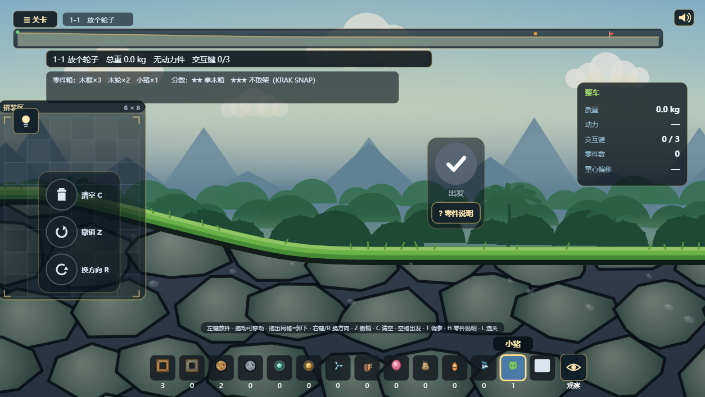
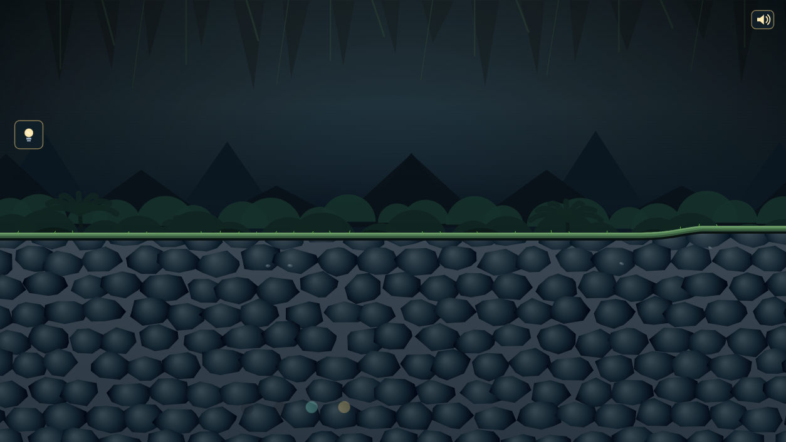
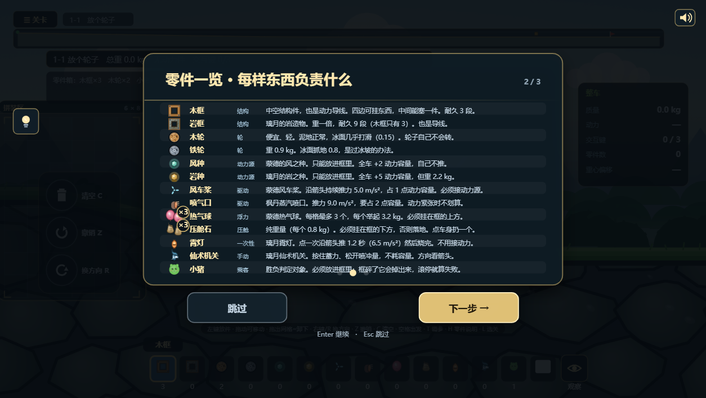
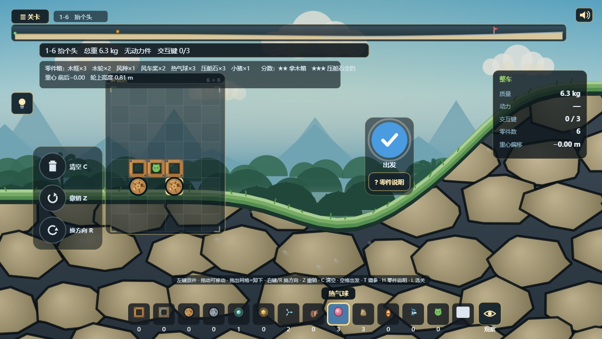

# 滚蛋吧！猪 · roll-away-pig

千星奇域（原神 UGC）2D + Lua 游戏的原型工程：一个《捣蛋猪》式的**造车解谜**垂直切片，
首版范围 1-1 ~ 1-6 共八关，横屏 1280×720。

> 交付物最终是**能在千星沙箱模拟器与真机里跑起来的 Lua + 存档**；
> 本仓库里 `prototype/` 那套 HTML 是**步骤 3 的效果展示与物理/演出调参台**，
> 用来在写 Lua 之前把画面、手感、引导打磨到位。它不是最终产物。

---

## 1. 三十秒上手（不用装任何东西）

双击 `prototype/index.html` 就能玩。纯本地文件，不需要服务器、不需要 `npm install`。

| 想干什么 | 怎么操作 |
|---|---|
| 选零件 | 点底部托盘；**再点一次同一个 = 取消选中** |
| 放零件 | 点网格格子（必须贴着已有结构）；同一格连点 = 1→2→3 叠放 |
| 换位置 | 按住已放的零件拖动；**拖出网格松手 = 卸下**，零件回到待使用 |
| 转方向 | 右键点格子，或按 `R` |
| 撤销 / 清空 | `Z` / `C`（一次 Z = 整张图纸回到上一步） |
| 看地图 | 建造期右键拖动平移、滚轮缩放；或点托盘右边的**「观察」**键后用 `WASD`、手机上长按出浮动摇杆（松手即消失） |
| 发射 | 空格，或右侧蓝色对勾 |
| 行驶期 | `1` `2` `3` 或左下按钮 = 交互键；**点车身** = 扔沙袋 / 扎气球 |
| 卡关了 | 左上角「提示」键，分三层递进给（第一层只给方向，第三层给答案） |
| 暂停 | `Esc` |
| 调参 | `T` 打开数值面板（重力、抓地、冲量……用于调手感） |

六关都通了之后可以回头用不同零件刷第二、第三颗星（星星是**唯一**的进度货币）。

---

## 2. 长什么样




<details>
<summary>更多截图（结算 / 选关 / 零件说明 / 1-6 热气球关）</summary>






</details>

> 这些图是**某一轮的历史快照**，界面还在改；要看当前状态就直接双击 `index.html`。
> 自动化测试拍的两百多张过程图在 `records/shots/`（不入库，见 `.gitignore`）。

---

## 3. 仓库地图

```
prototype/            步骤 3 的 HTML 效果展示（可直接双击运行）
  index.html          全部渲染 + UI + 输入（单文件内联脚本，约 5900 行）
  game.js             纯逻辑引擎：零件表、物理步进、关卡记账（Node 里可 require）
  levels.js           由 levels/*.json 生成的打包产物（浏览器/Node 都能读）
  check_html_logic.js 40 项数值校核（物理/关卡是否真的成立）
levels/               关卡数据 01..06.json（唯一出口是 tools/build_levels_js.js）
tests/                TDD 用例（cases.md + t01..t15.json）
tools/                自动化测试与量具（见第 4 节）
docs/                 策划案、美术圣经、零件重设计、参考拆解、制作计划
docs/collaboration.md 多人协作须知：谁改哪里、五条硬规矩、无头测试的坑
docs/screenshots/     挑出来的几张界面图（入库，README 引用）
records/playtest.md   逐轮试玩记录（2397 行）：每轮改了什么、为什么、量到了什么数
records/shots/        自动化测试拍的两百多张过程图（**不入库**，见 .gitignore）
```

**唯一真源**：`prototype/index.html` + `prototype/game.js`。`levels.js` 是派生产物，
不要手改；改 `levels/*.json` 后跑 `node tools/build_levels_js.js` 重新生成。

---

## 4. 怎么验证没改坏

```bash
node prototype/check_html_logic.js   # 40 项数值校核，约 2 秒
node tools/check_inline_js.js        # 内联脚本语法
node tools/verify.mjs                # 全量：数值 + 98 项自检（含真实浏览器交互），约 8 分钟
node tools/verify.mjs --fast         # 只跑数值部分
```

`tools/verify.mjs` 会用**真实 Edge 无头浏览器 + CDP 真鼠标键盘**把每个功能点玩一遍，
退出码非 0 就是有失败项。判定规则在 `tools/lib/verdict.js`：
必须 `ASSERTS n / n` 全过 **且** `errors: (none)`，唯一豁免是脚本显式打印 `RUNTIME: node`。

> 本项目的测试是**量具**，不是仪式。每条断言都必须先证明它**能变红**
> （把修复 stash 掉重跑一次，确认失败），否则它就是一条永远为真的空断言。
> 这条规矩写在 `docs/production-plan.md`，被违反过很多次，见 `records/playtest.md`。

---

## 5. 协作约定

这几条是这个工程踩过坑之后定下的，请务必遵守：

1. **含中文的文件只能用编辑器/工具改**，不要用 `PowerShell` 的 `Set-Content` / `-replace`
   写它们 —— 会变成乱码 + BOM。受害者已经包括 `game.js`、`index.html`、`levels.js`、
   `docs/*.md`、`tools/*.js`。
2. **几何与绘制必须共用一份**。按钮矩形、托盘槽位、零件页行高都是"画的时候用的那个函数"
   导出来给测试读（`btnRect()`、`trayRect()`、`state.partsPageRows`），
   测试不许另抄一份公式 —— 抄出来的那份迟早和画面走散。
3. **测试和产品一起改**。某个被测量的对象没了（比如刹车键被删），就把它的测试一起埋掉，
   而不是留一条永远为真的断言。
4. **关卡数据的唯一出口**是 `tools/build_levels_js.js`，它会拒绝任何未登记的字段。
   `tools/` 里其余 `make_*.py` / `fix*.py` / `iter*.py` 是**一次性历史脚本**，
   多数已经过期（生成出来的东西和现在的数据不是一回事），别拿它们当工具用。
5. 提交信息写**"改之前哪里是坏的"**，不要写"update"。
   现成的范例：`round63: the car was a pile of parts, not a car`。

> 完整的协作说明在 **[docs/collaboration.md](docs/collaboration.md)**：
> 按文件族的分工表、无头浏览器测试的六个坑、以及"怎么证明你的测试不是空断言"。

---

## 6. 当前进度

| 工作室流程 | 状态 |
|---|---|
| 1. 策划案 | ✅ `docs/gdd.md`（v0.3，含 13 件零件表与三条核心机制） |
| 2. TDD 用例 | ✅ `tests/cases.md` + 15 个 JSON |
| 3. HTML 效果展示 | ✅ 可玩，七轮打磨中（最近：世界锚定的拼装区 + 观察键/虚拟摇杆） |
| 4. 千星美术参考与素材 | ✅ `docs/art-bible.md`、`docs/art-catalog.md`（官方 imageId 实测只覆盖 UI） |
| 5. Lua 实现 | ⬜ 下一步 |
| 6. 模拟器测试 | ⬜ |
| 7. 真机试玩 | ⬜ |

设计上的硬决定（不再重开讨论）：六关垂直切片、横屏 1280×720、
**星星是唯一货币（金币已删）**、**没有刹车键**、**没有"动力容量"这种数值条**，
风力/岩力/雷力按"一次性范围事件"设计而不是攒能量。

---

## 7. 想改哪里从这里开始

- 改**手感/物理** → `prototype/game.js` 的 `Params` 与 `step()`；配套读 `docs/parts-redesign.md`
- 改**画面/UI** → `prototype/index.html`；先看 `docs/art-bible.md` 的四层景深与调色板
- 改**关卡** → `levels/*.json` 然后跑 `tools/build_levels_js.js`；形状由 `tools/lib/level_schema.js` 把关
- 加**新零件** → `game.js` 的 `PARTS` / `TRAY_ORDER` / `powerGrid` / `step()`，
  再补一条 `tools/test_*.js` 证明它真的带动车
- 想知道**某一轮为什么这么改** → `records/playtest.md` 搜轮次号，那里有实测数字和失败原因
